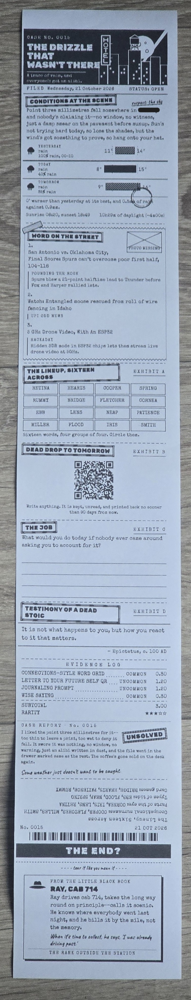
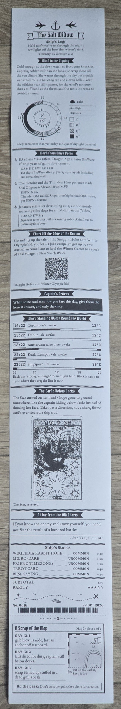

# Mini Gute

A thermal receipt printer that prints an LLM-powered personal brief every morning.

Built in Python. Each page is laid out in HTML and CSS (Jinja2 templates, one
stylesheet per persona), rendered by headless Chromium through Playwright,
thresholded to a 1-bit bitmap with Pillow, and sent to the printer as raw ESC/POS
over USB. The voice comes from the Claude API, and the machine's memory is a
single SQLite file.


Each run prints the day's weather and news, plus three to six rotating print
slots drawn by rarity:

- **Common**, like:
  - the moon phase
  - a quote from a book on your own read list
  - a tarot card pull, interpretated
  - a joke or fun fact
  - a strange Wikipedia article, with a QR code to go read deeper
- **Uncommon**, like:
  - the painting of the day with its backstory and context
  = a micro-dare: one small mission to do today.
  - friends' timeline clocks: who is awake, how warm it is there, when to call
  - a dead drop: coordinates within walking distance, to go and photograph
  - a letter to your future self, emailed now and printed back months later
- **Rare**, like:
  - tonight's star chart, or when to see the ISS go over
  - a city map that grows one tile a morning, to tape on the wall
  - a short story told in three parts, over three mornings
- **+ Many more (Even some Legendary??)**

Slots are built in Python, often fetching the data they need from public APIs such as:

- **Open-Meteo** for the weather, and the temperature in your friends' cities
- **RSS feeds** for the news, ranked against a profile of what you care about
- **The Met, the Art Institute of Chicago and the Cleveland Museum of Art** for
  paintings
- **asciiart.eu** For equaly beautiful ASCII art
- **CelesTrak** for the ISS's orbit (the planets and stars are computed locally)
- **XKCD**, **Goodreads**, **Wikipedia**, **random.org** and many more...

All of this is wrapped and themed according to a rotating cast of 16 "personas"
that add flavor to each print. Each persona brings its own print style and
layout, as well as a narration style that characterizes the whole receipt. Each
morning the document might be:

- **The Victorian Clerk:** a ledger, the day booked in like a delivery
- **OPS:** an operation order, with a mission for the day
- **The Noir Detective:** a case file, opening on a rain-soaked street
- **The First Mate:** a pirate ship's log, with a piece of a treasure map to cut out
- **The Oracle:** a page torn from a grimoire, tonight's moon on top
- **The Daily Roll:** a tabloid front page that thinks you're the biggest celebrity alive
- **The Bootleg Tape:** the inlay card of a mixtape about your day
- **Accounts Receivable:** a quarterly report on a company whose only asset is you,
  with your share price
- **Dot's All-Nite Diner:** a menu and an order ticket
- **The Stage Manager:** a playbill and the prompt book for tonight's one-night-only
  production of your day
- **The Commentary Box:** two old pundits calling your day live, in a different
  sport every morning
- **The Monkey Astronaut:** a flight-data file from a lonely capsule
- **The Machine:** the printer's own diagnostic output, slowly becoming self-aware
- **The Time Traveller:** a receipt from a couple of centuries ahead, downgraded to
  run on paper
- **The Revolutionary:** intercepted transmissions, enciphered for real
- **The Mimic:** something wearing yesterday's persona, and getting it slightly wrong

Persona narration is achieved through the Claude API, with instructions for
each persona in `personas/personas.toml`.


## Examples

Two real mornings, as printed. Zoom in for details.

<table>
  <tr>
    <td align="center" valign="top" width="50%">
      <br>
      <b>The Noir Detective</b><br>
      <sub>A case file: the weather as conditions at the scene, the news as word
      on the street, a word grid, a journaling prompt, and a contact from the
      little black book as the coupon.</sub>
    </td>
    <td align="center" valign="top" width="50%">
      <br>
      <b>The First Mate</b><br>
      <sub>A ship's log: a weather dial, the news as word from other ports,
      friends' clocks, a tarot card, and a piece of a treasure map to cut out.</sub>
    </td>
  </tr>
</table>


## Hardware

Built for an **Epson TM-T20II with an 80mm roll** (576 dots across at 203dpi),
written to straight over USB through the Windows `usbprint.sys` interface - no
driver install, no print queue. Printing therefore needs Windows and `pywin32`;
everything else, including PNG previews, runs anywhere Python and Chromium do.

A different ESC/POS printer should work if it is 203dpi and 576 dots wide. The
page threshold and type sizes were measured on this one, and `tools/` has the
calibration prints to redo that (see `docs/SYSTEM.md` §1.1).

## Setup

Python **3.11, 64-bit** - the pinned versions do not install on anything newer.

```bash
py -3.11 -m venv .venv
```

```bash
.venv/Scripts/python.exe -m pip install -r requirements.txt
```

```bash
.venv/Scripts/python.exe -m playwright install chromium
```

Then make it yours. Every personal value lives in a gitignored file with a
committed example beside it:

| File | What goes in it |
|---|---|
| `.env` (from `.env.example`) | your name, location, Anthropic API key, the input-channel mailbox, birthday, friends' timezones |
| `data/profile.md` (from `profile.example.md`) | what you want from the news, as prose - the ranker reads it |
| `data/books.txt` (from `books.example.txt`) | your read list, for the book-quote section |
| `config.local.toml` (optional) | your own news feeds, and any other override of `config.toml` |

Nothing is required to get a first render:

```bash
.venv/Scripts/python.exe main.py --preview --offline
```

That writes `out/receipt.png` from the bundled fixtures, with no network and no
API call. `python tools/checklocation.py` confirms your coordinates are where the
location name says they are.

## Usage

```bash
python main.py --preview            # render today to out/receipt.png, no printing
python main.py --preview --offline  # fixtures only, no network, no API call
python main.py --date 2026-12-21    # force a date (a simulation, never recorded)
python main.py --persona oracle     # force a persona
python main.py --legendary any      # force a legendary format
python main.py --dry-run            # full pipeline, no paper
python main.py --contact-sheet 30   # 30 simulated days side by side; offline, never recorded
python main.py                      # print
python tools/printpng.py out/x.png  # print a saved preview exactly as seen
python tools/printed.py 7           # what the last 7 real mornings actually said
python tools/slotcheck.py           # slot coverage + offline fixture smoke test
python tools/personacheck.py        # every persona's wiring
python tools/papercheck.py          # every slot's paper cost against its claim
```

A real morning (no `--date`) is recorded in `data/cache.sqlite`: serial numbers,
which persona and sections printed, what each section said (with the page
kept in `out/archive`), and the history the personas and the selection engine
remember. On Windows, `tools/shortcut.ps1` makes a desktop
shortcut that prints the morning and logs the run.

## How it works

```
pick_persona  ->  selection.select  ->  collectors  ->  narrator  ->  render  ->  printer
```

1. **A persona is drawn** from sixteen, by rarity tier and damped by recency.
2. **Today's sections are drawn** - 3 to 5 rotating slots, tier-weighted,
   recency-damped and fitted to the paper budget - plus a separate 1-in-25
   legendary roll.
3. **Only the drawn slots fetch.** Each returns a typed result or `None`;
   `safe_fetch` makes it impossible for one to crash the morning.
4. **One Claude call writes the voice** for every section against a JSON schema
   built from the day's draw. Facts that must survive verbatim - headlines,
   quotations, figures - get no field the model could rewrite them in.
5. **The page renders** as HTML at 576px, the persona's stylesheet on top,
   through headless Chromium, thresholded to 1-bit. Photographs are dithered
   before they reach the page, never after.
6. **It prints** as ESC/POS raster, and the morning is recorded.

## Layout

| Path | |
|---|---|
| `main.py` | the pipeline, personas and page assembly |
| `selection.py` | the rarity engine |
| `narrator/` | the Claude calls |
| `legendary.py`, `cipher.py` | legendary formats; the Revolutionary's real ciphers |
| `slots/` | one module per section (or family of sections), self-registering |
| `sources/` | the data sources the slots share: weather, RSS, Wikipedia, museums, sky, mail |
| `render/` | HTML to 1-bit, dithering, fonts, charts, barcodes, QR, weather layouts, treasure maps |
| `printer/` | ESC/POS encoding, the Windows USB backend, the PNG preview |
| `personas/` | `personas.toml` (voices, mastheads, blocks) and one stylesheet per persona |
| `templates/` | the receipt shell |
| `assets/` | fonts, fixtures, tarot cards, ASCII art, poems, stories, tunes |
| `tools/` | checks, calibration prints, asset harvesters, the launcher |
| `docs/` | how it all works (below) |

## Docs

- [`docs/SYSTEM.md`](docs/SYSTEM.md) - how the machine works: hardware limits,
  personas, rarity, series, the input channel, failure handling
- [`docs/SLOTS.md`](docs/SLOTS.md) - the catalogue of every section, built or not
- [`docs/SLOT-STATUS.md`](docs/SLOT-STATUS.md) - how each built section actually
  works
- [`docs/ROADMAP.md`](docs/ROADMAP.md) - where it stands and what is left
- [`CLAUDE.md`](CLAUDE.md) - the invariants and conventions, for anyone (or any
  model) changing the code

## Credits

- Fonts from [Google Fonts](https://fonts.google.com), under their own open
  licences (mostly the SIL Open Font License), embedded in `assets/fonts/`.
- Tarot: the Rider-Waite-Smith deck (1909), illustrated by Pamela Colman Smith;
  public-domain scans from Wikimedia Commons (`assets/tarot/SOURCE.md`).
- ASCII art harvested from [asciiart.eu](https://www.asciiart.eu); the artist is
  credited on the receipt where the site names one.
- Short stories from [Project Gutenberg](https://www.gutenberg.org) collections,
  public domain.
- Unusual articles from Wikipedia's
  [Unusual articles](https://en.wikipedia.org/wiki/Wikipedia:Unusual_articles)
  list (CC BY-SA).
- [abcjs](https://github.com/paulrosen/abcjs) (MIT) renders the sheet music.
- Weather and geocoding from [Open-Meteo](https://open-meteo.com); map tiles
  © [OpenStreetMap](https://www.openstreetmap.org/copyright) contributors.
